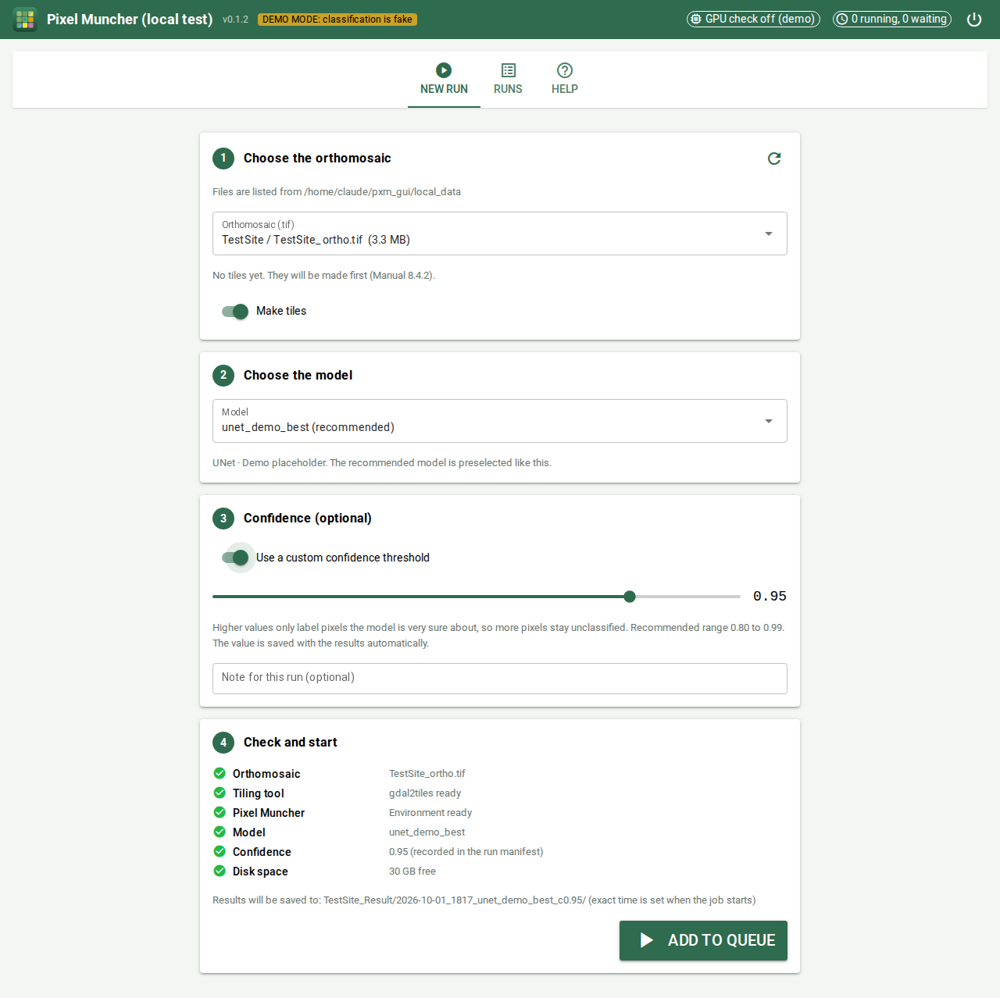
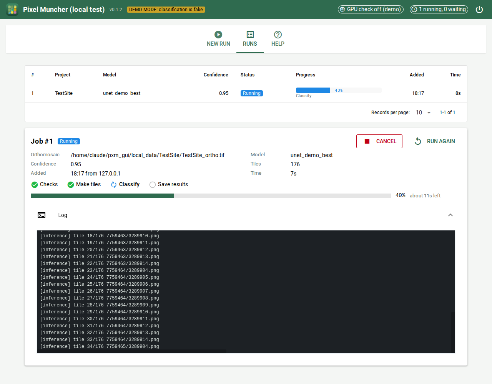
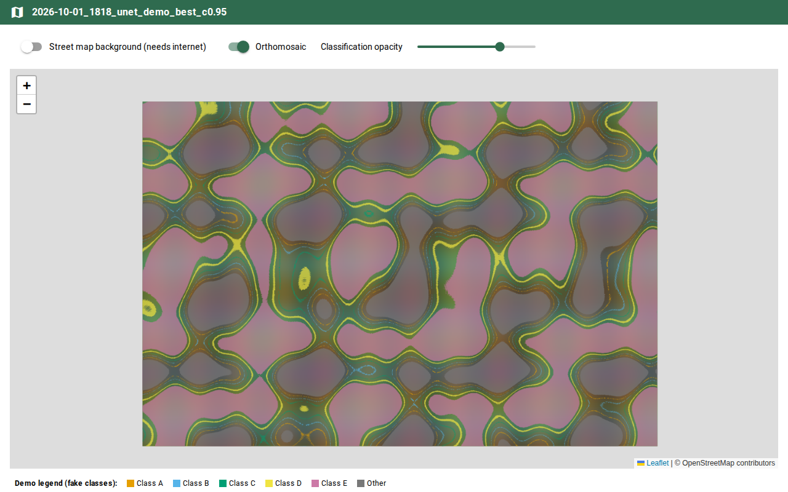

# Pixel Muncher GUI

A browser front end for the Pixel Muncher vegetation classification workflow
(processing manual, Chapter 8). An analyst picks an
orthomosaic, a model and an optional confidence threshold, then presses
**Add to queue**. The app runs tiling and inference on the GPU workstation,
copies the results into the project folder and writes a record of the run.
Nobody has to open a terminal.



> Status: v0.1.3. The app is built from the manual and tested end to end with
> stand-in tools (see `mock/`). It has not yet been run against the real
> Pixel Muncher code. Do the [first real run checklist](#first-real-run-checklist)
> before handing it to analysts.

## What it replaces

| Manual step | Before | With the app |
|---|---|---|
| 8.4.2 Tile the imagery | `cd`, `source <tiling-env>/bin/activate`, long `gdal2tiles.py` command | Automatic. Existing tiles are detected and reused |
| 8.4.3 Run Pixel Muncher | `cd`, activate the inference environment, type `inference.py -p ... -i ... -pp ...` | Automatic. The app calls the environment's Python directly |
| 8.4.4 Choose a model | Type the path to a `.json` file | Dropdown, with the recommended model preselected |
| 8.5 Confidence threshold | `-a '{"pytorchseg_confidence_threshold": 0.99}'` | Slider from 0.80 to 0.99 |
| 8.4.6 Organise results | Copy, rename to `23/`, copy `log.log` and the HTML viewers | Automatic |
| 8.4.7 View the classification | Open `openlayers.html` (needs internet) | **Open map**: classification over the orthomosaic with an opacity slider, works offline |
| 8.8 Traceability | Write down model, threshold and paths by hand | `run_manifest.json` and a copy of the model config saved with every result |

Jobs wait in a queue and run one at a time, because they share one GPU. The
queue is stored in SQLite, so it survives a restart. Analysts can close the
browser while a job runs.



## Requirements

On the processing workstation (the GPU workstation in the manual):

- Linux with an NVIDIA GPU, a working driver (`nvidia-smi` prints the GPU) and CUDA.
- Pixel Muncher and its inference environment, installed as described in Chapter 8.
- The tiling environment with `gdal2tiles.py`.
- Python 3.10 or newer with the `venv` module. Check with `python3 --version`.
- Internet access to PyPI for the one-time `pip install`.
- Port 8080 reachable from the office network, if other PCs should use the app.

The app does not install anything into the Pixel Muncher or tiling
environments. It runs from its own virtual environment and only calls those
environments' Python executables.

## Install on the company workstation

Do these steps on the GPU workstation, logged in (locally or over Remote
Desktop, see Chapter 12) as the Linux user that owns the Pixel Muncher folders.

### 1. Get the code

```bash
cd ~
git clone https://github.com/<your-account>/pixel-muncher-gui.git
cd pixel-muncher-gui
```

Without git, copy the folder onto the workstation instead and `cd` into it.
Keep the folder name `pixel-muncher-gui` if you plan to use the service in step 7.

### 2. Create the app's own Python environment

```bash
python3 -m venv .venv
.venv/bin/pip install --upgrade pip
.venv/bin/pip install -r requirements.txt
```

If the first command fails with `ensurepip is not available`, install the
venv package once (`sudo apt install python3-venv`) and run it again.

### 3. Set the paths for this workstation

The repository only contains a template with placeholders. Create the real
config from it:

```bash
cp config.example.yaml config.yaml
nano config.yaml
```

`config.yaml` is listed in `.gitignore`, so the internal paths and user names
you type into it stay on the workstation, and `git pull` never overwrites
them. Take the values from Chapter 8 of the manual and from the command notes
kept on the workstation. Where the two disagree, the notes on the workstation
are more recent.

| Key | Example | What it is |
|---|---|---|
| `data.root` | `~/data` | Folder that holds the project folders. Each orthomosaic must be inside its own project folder |
| `tiling.python` | `/home/<user>/<tiling-env>/bin/python3` | Python of the tiling environment (Manual 8.4.2) |
| `tiling.script` | `/home/<user>/<tiling-env>/bin/gdal2tiles.py` | The tiling script. `module:osgeo_utils.gdal2tiles` also works |
| `inference.workdir` | `~/<pixel-muncher-folder>` | Pixel Muncher folder. Inference runs from here |
| `inference.python` | `<workdir>/<inference-env>/bin/python3` | Python of the inference environment (Manual 8.4.3) |
| `inference.models_dir` | `~/<models-folder>` | Searched recursively for model `.json` files |
| `inference.results_dir` | `<workdir>/results` | Where Pixel Muncher writes its timestamped run folders |
| `inference.output_subfolder` | `segmentation_rgb` | Folder inside each run that holds the classified tiles |
| `inference.extra_args` | `[]` | Extra flags for `inference.py`, for example `["-nrd"]` |
| `models.recommended` | name of a model `.json`, without `.json` | Preselected model (Manual 8.4.5) |
| `results.layout` | `per_run` | `per_run` gives each run its own folder. `manual` uses `<Project>_Result/23/` exactly as in 8.4.6 |
| `app.port` | `8080` | Web port |

### 4. Check the setup

```bash
./run.sh --check
```

The command tests every path, the models folder, write access to the results
folder, the GPU and the free disk space, then exits. Fix every `ERROR` line
in `config.yaml` and run it again until the last line says
`All checks passed.` A healthy workstation looks like this:

```
[OK   ] Config file              /home/<user>/pixel-muncher-gui/config.yaml
[OK   ] Data folder              /home/<user>/data (4 orthomosaic(s) found)
[OK   ] Tiling tool              /home/<user>/<tiling-env>/bin/gdal2tiles.py
[OK   ] Inference Python         /home/<user>/<pixel-muncher-folder>/<inference-env>/bin/python3
[OK   ] Models                   8 found
[OK   ] GPU                      NVIDIA GeForce RTX 4070 (0.4 / 12.0 GB used)
...
All checks passed.
```

### 5. Start the app and do a first run

```bash
./run.sh
```

Open http://localhost:8080 in a browser on the workstation. Pick a small
orthomosaic and run it with the recommended model. While it runs, work
through the [first real run checklist](#first-real-run-checklist). Stop the
app with `Ctrl+C`.

### 6. Open it from other office PCs

Find the workstation's IP address:

```bash
hostname -I
```

Other PCs on the office network can then open `http://<that-ip>:8080`. If the
page does not load, check whether Ubuntu's firewall is on, and allow the port
for the office subnet only. Adjust the subnet to match your network:

```bash
sudo ufw status
sudo ufw allow from <office-subnet> to any port 8080 proto tcp   # e.g. the /24 your PCs are on
```

### 7. Keep it running after you log out

Install the included systemd user service. It starts the app at boot and
restarts it if it crashes.

```bash
mkdir -p ~/.config/systemd/user
cp pxm-gui.service ~/.config/systemd/user/
systemctl --user daemon-reload
systemctl --user enable --now pxm-gui
sudo loginctl enable-linger $USER     # keep user services alive with nobody logged in
```

Useful commands:

```bash
systemctl --user status pxm-gui       # is it running?
systemctl --user restart pxm-gui      # after changing config.yaml or updating
journalctl --user -u pxm-gui -f       # live app log
```

If you cloned somewhere other than `~/pixel-muncher-gui`, edit the two paths
in `pxm-gui.service` before copying it.

## Desktop icon

The app runs as a service on the workstation, so on most PCs the "icon" is a
shortcut that opens it in its own window, without browser tabs or an address
bar. It looks and behaves like a normal desktop program.

Office Windows PCs (Microsoft Edge):

1. Open `http://<workstation-ip>:8080` in Edge.
2. Menu (`...`) > *Apps* > *Install this site as an app* > *Install*.
3. In the window that follows, tick *Pin to taskbar* and *Create desktop shortcut*.

With Google Chrome: menu (`⋮`) > *Cast, save and share* (older versions:
*More tools*) > *Create shortcut*, tick *Open as window*, then *Create*.
Either way, Pixel Muncher appears in the Start menu with its own icon.

On the workstation itself (Linux), add an icon to the application menu and
the desktop:

```bash
bash launchers/linux/install_desktop_icon.sh
```

The icon starts the service if it is not running, waits until the app
answers, then opens it in a Chrome, Chromium or Edge app window, or in the
default browser if none of those is installed.

On a Mac used for testing, see
[docs/LOCAL_TESTING.md](docs/LOCAL_TESTING.md#7-make-a-mac-app-icon).

## Using the app

1. **New run** tab: choose the orthomosaic. If tiles already exist in
   `<Project>/23/`, the app reuses them. Turn on *Make tiles* only if the
   orthomosaic changed.
2. Choose the model. The recommended one is preselected.
3. Optionally set a confidence threshold. Leave it off to use the model's default.
4. Read the checks in step 4. Red items block the run and say what to fix.
   Press **Add to queue**.
5. **Runs** tab: progress, estimated time left, live log, *Cancel* and *Run again*.
   When the job is done, *Open map* shows the result.

Results are saved next to the project folder:

```
SiteA_Result/
  2026-10-01_1430_<model>_c0.95/
    23/                  classified tiles
    log.log              Pixel Muncher log
    openlayers.html      gdal2tiles viewers (need internet)
    model_config/        copy of the model .json used
    run_manifest.json    who ran it, when, input file, model, threshold, exact commands
```

With *Make tiles* on, existing tiles are renamed to
`23_previous_<timestamp>/` instead of being deleted.



## First real run checklist

The app was written from the manual without access to the real scripts.
Confirm these on the first run and adjust `config.yaml` where needed:

- [ ] Pixel Muncher writes classified tiles into `segmentation_rgb/`. Manual
      8.9.6 calls the folder `segmentation_rgb_map`. Set
      `inference.output_subfolder` to whichever name appears.
- [ ] The classified tiles keep the same `<x>/<y>.png` names as the input
      tiles. *Open map* depends on this.
- [ ] The *Classify* progress bar moves during inference. It counts output
      files as they appear. If Pixel Muncher writes everything at the end,
      the bar jumps from 0 to 100% and the job still works.
- [ ] The confidence threshold is on a 0 to 1 scale. Manual 8.5 says 0 to 100,
      but the commands in 8.7.7 use `0.99`. The app sends 0 to 1.
- [ ] Find out what `-nrd` does. The batch scripts pass it, and the manual
      does not explain it. Add it to `inference.extra_args` if it is needed.
- [ ] Open `run_manifest.json` from the finished run and check that the
      commands match the command notes on the workstation.

## Updating

```bash
cd ~/pixel-muncher-gui
git pull
.venv/bin/pip install -r requirements.txt
./run.sh --check
systemctl --user restart pxm-gui
```

Job history is stored in `~/.pxm_gui/` and survives updates.

## Troubleshooting

| Problem | Fix |
|---|---|
| `Address already in use` on start | Another program uses port 8080. Change `app.port` in `config.yaml` |
| Other PCs cannot open the page | Check `hostname -I`, that `app.host` is `0.0.0.0`, and the firewall (step 6) |
| Header says *GPU not available* | `nvidia-smi` failed. Check the driver. Jobs are blocked until it works |
| A job failed | The red box in the *Runs* tab gives the reason. The full log is under *Log*, and in `~/.pxm_gui/logs/job_<id>.log` |
| Job shows *Interrupted* | The app was restarted while the job ran. Press *Run again* |
| GPU out of memory | Wait for other GPU work to finish, then press *Run again* |
| An orthomosaic is missing from the list | It must sit inside a project folder under `data.root`, at most `data.scan_depth` levels deep. Press the refresh button |

## Testing without the GPU

Two modes run on any Mac or Linux laptop:

```bash
./run.sh --mock     # fake data, fake tiling, fake classification
./run.sh --local    # your own .tif, real tiling with GDAL, fake classification
```

See [docs/LOCAL_TESTING.md](docs/LOCAL_TESTING.md) for step-by-step
instructions. A Vietnamese version is in
[docs/vi/HUONG_DAN_MAC.md](docs/vi/HUONG_DAN_MAC.md). Windows is not
supported. Use WSL there.

## Development

```
app.py               web interface (NiceGUI): New run, Runs, Help, /map
assets/              app icon (PNG, ICO, ICNS) and web app manifest
launchers/           desktop icons: macOS .app builder, Linux .desktop installer
tools/make_icons.py  redraws the icon files in assets/
pxm/config.py        loads config.yaml
pxm/catalog.py       finds orthomosaics, tiles, models; tile bounds for the map
pxm/commands.py      builds the gdal2tiles and inference.py command lines
pxm/preflight.py     checks shown before a run, and ./run.sh --check
pxm/jobs.py          SQLite job queue
pxm/pipeline.py      worker thread: checks, tiles, classify, save results, manifest
mock/                stand-in tiler and inference for demo, local and test runs
tests/               end-to-end tests using the mock tools
config.example.yaml  production config template (copy to config.yaml, which is git-ignored)
config.mock.yaml     demo mode
config.local.yaml    laptop test with real tiling
```

Run the tests:

```bash
.venv/bin/pip install pytest
.venv/bin/python -m pytest -q
```

Commands are built as argument lists and run without a shell, so file names
with spaces or quotes are passed through unchanged.

## Security

The app has no login. Anyone who can reach the port can queue jobs and view
the tiles and files under `data.root`, which are served read-only. Keep it on
the office network. Add authentication before exposing it outside that network.

## Keeping company data out of git

`.gitignore` blocks the files that must stay inside the company: the real
`config.yaml`, imagery (`.tif`, `.las`, ...), results folders, model weights,
job history and logs, manuals and documents, credentials (`.env`, keys,
Azure and Remote Desktop files) and zip archives. The list is grouped and
commented in `.gitignore` itself.

`.gitignore` only covers whole files. It cannot stop a company name, an IP
address or a password that someone types into a file that is tracked. For
that, install the pre-commit check once per clone:

```bash
cp tools/secret-patterns.example .secret-patterns.local   # then add your own words
bash tools/install_git_hook.sh
```

Before every commit, `tools/check_secrets.sh` searches the staged changes for
the words in `.secret-patterns.local` (git-ignored, so the list itself stays
private), for private IP addresses, passwords and keys, and for large or
binary files. The commit stops if anything matches. Run
`bash tools/check_secrets.sh --all` to scan every tracked file.

Keep the GitHub repository private as well.

## Roadmap

- v0.2: *Export GeoTIFF* button. Stitch tiles by their tile coordinates and
  georeference them from the zoom level, replacing `merge_tiles.sh` and
  `conv_output_tiff.py` (removes their RAM limit and hard-coded crop bounds).
- v0.3: *Validation* tab. Run against ground truth across several thresholds
  and show per-class IoU with comparison images and CSV export, replacing
  `run_validation.sh`, `validation_rgb.py` and `format_val_output.py`.
- Show the real Pixel Muncher class colours as a legend on the map.
